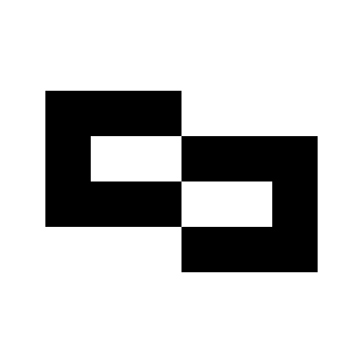

# Deepbank & Clavius — Brand Assets & Visual Identity

Repositorio central de identidad visual, recursos gráficos, logos vectoriales de alta resolución y manuales de marca para **Deepbank** y el holding **Clavius**.

---

## 📁 Estructura del Repositorio

```
brand-assets/
├── README.md                           # Índice general y guía de integración
├── DEEPBANK-BRANDING.md                # Manual Maestro de Marca & Identidad de Deepbank
├── BRANDING.md                         # Manual de Marca y Tesis de Clavius
├── banners/
│   └── linkedin-banner.png             # Banner oficial para LinkedIn (Clavius)
└── logos/
    ├── deepbank/                       # 🏦 Activos Oficiales de Deepbank
    │   ├── deepbank-logo-dark.svg      # Isotipo para fondo oscuro (Caja blanca, glifo negro)
    │   ├── deepbank-logo-light.svg     # Isotipo para fondo claro (Caja negra, glifo blanco)
    │   ├── deepbank-glyph-white.svg    # Glifo aislado blanco (Transparente)
    │   ├── deepbank-glyph-black.svg    # Glifo aislado negro (Transparente)
    │   ├── deepbank-glyph-emerald.svg  # Glifo aislado esmeralda liquidez (Transparente)
    │   ├── deepbank-horizontal-dark.svg# Lockup horizontal con isotipo + texto "Deepbank"
    │   ├── deepbank-horizontal-light.svg
    │   ├── deepbank-logo-dark.png      # PNG 2500×2500 px alta resolución
    │   ├── deepbank-logo-light.png     # PNG 2500×2500 px alta resolución
    │   ├── deepbank-glyph-white.png    # PNG 2500×2500 px glifo blanco
    │   ├── deepbank-glyph-black.png    # PNG 2500×2500 px glifo negro
    │   └── icon.svg                    # Favicon / App icon
    ├── clavius/                        # 🪐 Activos Oficiales de Clavius
    │   ├── logo-white.svg              # Isotipo oficial en blanco puro (fondos oscuros)
    │   ├── logo-black.svg              # Isotipo oficial en negro obsidiana (fondos claros)
    │   ├── logo.svg                    # Vector institucional estándar
    │   └── icon.svg                    # Favicon / App icon
    ├── deepbank-logo-for-dark.svg      # Enlace directo de compatibilidad
    ├── deepbank-logo-for-light.svg     # Enlace directo de compatibilidad
    ├── deepbank-logo-for-dark.png      # Enlace directo de compatibilidad
    ├── deepbank-icon.svg               # Enlace directo de compatibilidad
    ├── logo-white.svg                  # Clavius (compatibilidad de rutas raíz)
    └── logo-black.svg                  # Clavius (compatibilidad de rutas raíz)
```

---

## 🏦 1. Deepbank — Activos de Marca

*Manual de Marca Completo:* [`DEEPBANK-BRANDING.md`](./DEEPBANK-BRANDING.md)

### Isotipo y Glifo

| Recurso | Descripción | Formato | Raw URL |
| :--- | :--- | :--- | :--- |
| **Dark Mode Isotype** | Caja blanca con glifo negro (para fondos oscuros/negros) | SVG / PNG (2500x2500) | [`logos/deepbank/deepbank-logo-dark.svg`](https://raw.githubusercontent.com/deepbank/brand-assets/main/logos/deepbank/deepbank-logo-dark.svg) |
| **Light Mode Isotype** | Caja negra con glifo blanco (para fondos claros/blancos) | SVG / PNG (2500x2500) | [`logos/deepbank/deepbank-logo-light.svg`](https://raw.githubusercontent.com/deepbank/brand-assets/main/logos/deepbank/deepbank-logo-light.svg) |
| **Glyph White** | Glifo vectorial en blanco puro sobre fondo transparente | SVG / PNG (2500x2500) | [`logos/deepbank/deepbank-glyph-white.svg`](https://raw.githubusercontent.com/deepbank/brand-assets/main/logos/deepbank/deepbank-glyph-white.svg) |
| **Glyph Black** | Glifo vectorial en negro obsidiana sobre fondo transparente | SVG / PNG (2500x2500) | [`logos/deepbank/deepbank-glyph-black.svg`](https://raw.githubusercontent.com/deepbank/brand-assets/main/logos/deepbank/deepbank-glyph-black.svg) |
| **Glyph Emerald** | Glifo vectorial en verde liquidez (`#10B981`) | SVG | [`logos/deepbank/deepbank-glyph-emerald.svg`](https://raw.githubusercontent.com/deepbank/brand-assets/main/logos/deepbank/deepbank-glyph-emerald.svg) |
| **Horizontal Dark** | Isotipo + Texto "Deepbank" en Google Sans para fondos oscuros | SVG | [`logos/deepbank/deepbank-horizontal-dark.svg`](https://raw.githubusercontent.com/deepbank/brand-assets/main/logos/deepbank/deepbank-horizontal-dark.svg) |
| **Horizontal Light** | Isotipo + Texto "Deepbank" en Google Sans para fondos claros | SVG | [`logos/deepbank/deepbank-horizontal-light.svg`](https://raw.githubusercontent.com/deepbank/brand-assets/main/logos/deepbank/deepbank-horizontal-light.svg) |

---

## 🪐 2. Clavius — Activos de Marca

*Manual de Marca & Tesis:* [`BRANDING.md`](./BRANDING.md)

| Recurso | Descripción | Formato | Raw URL |
| :--- | :--- | :--- | :--- |
| **Isotipo White** | Isotipo lunar concéntrico en blanco puro | SVG | [`logos/clavius/logo-white.svg`](https://raw.githubusercontent.com/deepbank/brand-assets/main/logos/clavius/logo-white.svg) |
| **Isotipo Black** | Isotipo lunar concéntrico en negro obsidiana | SVG | [`logos/clavius/logo-black.svg`](https://raw.githubusercontent.com/deepbank/brand-assets/main/logos/clavius/logo-black.svg) |
| **Banner LinkedIn** | Banner institucional oficial (1584×396 px) | PNG | [`banners/linkedin-banner.png`](https://raw.githubusercontent.com/deepbank/brand-assets/main/banners/linkedin-banner.png) |

---

## 🚀 Integración en Código

### En Next.js / React
```tsx
import Image from "next/image";

// Isotipo Deepbank para fondo oscuro
export function DeepbankLogo() {
  return (
    
  );
}

// Lockup horizontal con tipografía Google Sans
export function DeepbankHorizontalLogo() {
  return (
    
  );
}
```

### En HTML / Markdown
```html

```

---

## 🎨 Paleta de Colores de Deepbank

| Color | Hex | Uso |
| :--- | :--- | :--- |
| **Obsidiana** | `#000000` | Fondos principales (Pure Dark Estricto) |
| **Blanco Puro** | `#FFFFFF` | Logotipos, titulares y botones primarios |
| **Esmeralda Liquidez** | `#10B981` | Métricas de liquidez, estados aprobados |
| **Zinc / Neutro** | `#737373` / `#A3A3A3` | Subtítulos y metadatos secundarios |
